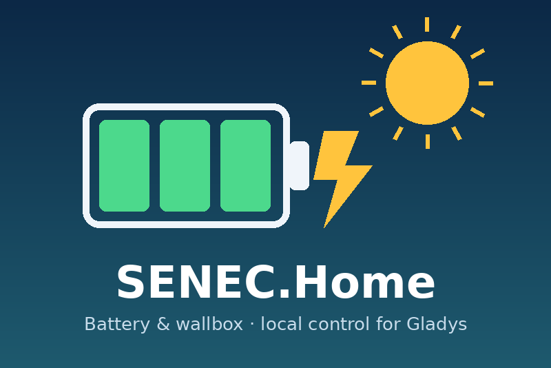

# SENEC.Home for Gladys Assistant

[](https://github.com/gboulvin/gladys-senec/actions/workflows/ci.yml)



An external integration for [Gladys Assistant](https://gladysassistant.com)
that brings your **SENEC.Home** battery storage system (V2.1, V3 hybrid /
hybrid duo) and its **SENEC.Wallbox** into Gladys — to monitor them, and to
control them.

- **100 % local**: read and controlled through `lala.cgi`, the local API of
  the SENEC web interface. No mein-senec.de account, no cloud.
- **Energy dashboard ready**: battery level, charge / discharge power, solar
  production, house consumption, grid import / export, energy indexes (older
  firmware), battery and case temperatures, system state.
- **Control**: start / stop the **safety charge** (charge the battery from the
  grid), set the **charging mode** of each SENEC.Wallbox (fast, solar
  optimized, locked).
- **Scenes**: triggers _battery full_, _battery empty_, _operating mode
  changed_, _solar surplus started / stopped_, _vehicle plugged / unplugged_;
  actions _read a SENEC.Home_, _safety charge_, _wallbox charging mode_.
- **Dashboard widgets**: _SENEC.Home_ overview and _SENEC.Wallbox_.
- **English, French, German and Spanish.**
- Requires **Gladys 5.3.0** or later.

SENEC.Home 4 / P4 systems have no local API and are not supported.

User documentation: [English](docs/en.md) · [Français](docs/fr.md) ·
[Deutsch](docs/de.md) · [Español](docs/es.md).

## Quick start

1. Give your SENEC.Home a fixed IP address, and check its web page opens at
   `https://<address>/`.
2. Install **SENEC.Home** from the integration catalog of Gladys.
3. In its **Configuration** tab, enter the IP address, save, then click
   **Test the connection**.
4. Add the system and its wallboxes from the **Discovery** tab.

## How it works

Every `poll_frequency` seconds (30 by default), the integration POSTs one
small JSON request to `https://<address>/lala.cgi`, listing the values it
wants; the system answers them hex-encoded (`fl_` floats, `u8_` integers,
`st_` strings), which [`src/lala.js`](src/lala.js) decodes. The values that
changed go to Gladys, the transitions fire the scene triggers, and the
dashboard widgets are refreshed. A command (safety charge, wallbox mode) is
the same request with the encoded value, followed by a fresh reading so the
device shows what the system confirms.

```
index.js                SDK wiring only
src/lala.js             lala.cgi client: value codec, chunked requests, session cookie
src/senec.js            identification, reading, commands, state tables
src/devices.js          Gladys devices and features (system + wallboxes)
src/installation.js     configured systems, reading loop, publications, commands
src/triggers.js         scene trigger detection
src/scenes.js           scene actions
src/widgets.js          dashboard widgets
src/actions.js          "Test the connection" button
```

The field names and the state tables come from the SENEC web interface, as
documented by the Home Assistant integration
[ha-senec-v3](https://github.com/marq24/ha-senec-v3) (Apache-2.0). Thanks to
its authors.

## Development

```bash
npm install
npm test               # node --test, against a simulated SENEC (test/helpers/fakeSenec.js)
npm run lint
npm run format:check
```

Run it against a real Gladys:

```bash
GLADYS_HOST_API_URL="http://localhost:1443" \
GLADYS_INTEGRATION_TOKEN="<token>" \
GLADYS_INTEGRATION_SELECTOR="senec-home" \
LOG_LEVEL=debug \
npm start
```

Releases go through **Actions → Release** (see [CLAUDE.md](CLAUDE.md)).

## License

Apache-2.0
